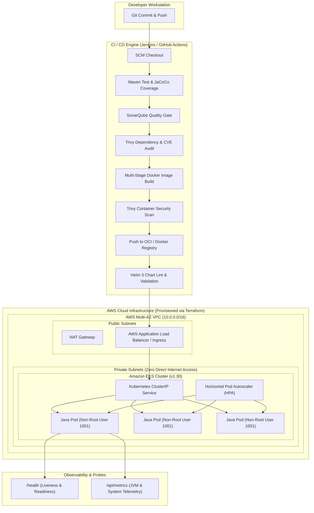

# Enterprise Java Cloud DevOps Platform

[](https://openjdk.org/)
[](https://www.docker.com/)
[](https://kubernetes.io/)
[](https://helm.sh/)
[](https://www.terraform.io/)
[](https://www.jenkins.io/)
[](https://www.sonarqube.org/)
[](https://trivy.dev/)
[](LICENSE)

An enterprise-grade, production-ready DevOps implementation featuring automated CI/CD pipelines, container orchestration, static code quality gates, vulnerability scanning, and multi-cloud infrastructure as code.

---

## 📑 Table of Contents

- [Architectural Overview](#-architectural-overview)
- [Enterprise Features](#-enterprise-features)
- [Repository Directory Structure](#-repository-directory-structure)
- [Core Technology Stack](#-core-technology-stack)
- [End-to-End CI/CD Pipeline](#-end-to-end-cicd-pipeline)
- [Local Development & Testing](#-local-development--testing)
- [Infrastructure as Code (Terraform)](#-infrastructure-as-code-terraform)
- [Kubernetes & Helm Deployment](#-kubernetes--helm-deployment)
- [Jenkins Pipeline Setup](#-jenkins-pipeline-setup)
- [Security, Probes & Observability](#-security-probes--observability)
- [Disaster Recovery & Zero-Downtime Rollback](#-disaster-recovery--zero-downtime-rollback)

---

## 🏗 Architectural Overview

The solution follows the AWS Well-Architected Framework and Cloud Native Computing Foundation (CNCF) industry standards.



---

## 🌟 Enterprise Features

| Domain | Enterprise Standard Implemented |
|---|---|
| **Application Layer** | Java 17 LTS, MVC Architecture, Gson API serializers, parameterized SQL injection protection, and JUnit 5 test suites. |
| **Containerization** | Multi-stage Dockerfile builds from clean source, distroless-hardened Tomcat base, runs as non-privileged UID `1001`, JVM heap tuning (`-XX:+UseG1GC`). |
| **CI/CD Pipelines** | Declarative Jenkinsfile + GitHub Actions workflow with strict SonarQube quality gate enforcement and Trivy vulnerability auditing. |
| **Orchestration** | Kubernetes 1.30 manifests with Horizontal Pod Autoscaling (HPA), Pod Disruption Budgets (PDB), NetworkPolicy, Pod Anti-Affinity, and Ingress TLS. |
| **Package Management** | Production Helm 3 chart with multi-environment overlays (`values-dev.yaml`, `values-staging.yaml`, `values-prod.yaml`). |
| **Infrastructure as Code** | Terraform AWS modules provisioning multi-AZ VPC with public/private subnet isolation and managed EKS node groups with encrypted gp3 storage. |
| **Observability** | Integrated `/health`, `/ready`, `/live`, and `/api/metrics` endpoints for Prometheus, Grafana, and kubelet probes. |

---

## 📂 Repository Directory Structure

```text
├── .github/
│   └── workflows/
│       └── ci-cd.yml                # Automated GitHub Actions CI pipeline
├── app/                             # Compiled WAR target distribution
├── helm/
│   └── java-app-chart/              # Production Helm 3 chart
│       ├── templates/
│       │   ├── _helpers.tpl         # Standard template definitions
│       │   ├── deployment.yaml      # Kubernetes deployment template
│       │   ├── service.yaml         # Kubernetes ClusterIP service template
│       │   ├── ingress.yaml         # Ingress routing template
│       │   ├── hpa.yaml             # Horizontal Pod Autoscaler template
│       │   ├── serviceaccount.yaml  # Dedicated IAM/K8s service account
│       │   └── NOTES.txt            # Deployment release notes
│       ├── Chart.yaml               # Helm chart descriptor
│       ├── values.yaml              # Default configuration values
│       ├── values-dev.yaml          # Development environment overlay
│       ├── values-staging.yaml      # Staging environment overlay
│       └── values-prod.yaml         # Production environment overlay
├── k8s/                             # Raw Kubernetes manifests (GitOps / Kustomize)
│   ├── namespace.yaml               # Dedicated production namespace
│   ├── configmap.yaml               # Externalized runtime configurations
│   ├── secret.yaml                  # Encrypted database & credentials template
│   ├── deployment.yaml              # High-availability rolling deployment
│   ├── service.yaml                 # ClusterIP load balancing service
│   ├── ingress.yaml                 # Ingress routing & TLS termination
│   ├── hpa.yaml                     # CPU & memory horizontal autoscaling
│   ├── pdb.yaml                     # Pod Disruption Budget
│   └── networkpolicy.yaml           # Zero-trust network segmentation
├── src/
│   ├── main/
│   │   ├── java/com/enterprise/devops/
│   │   │   ├── controller/          # HealthServlet, MetricsServlet, AuthServlet, UserServlet
│   │   │   ├── model/               # User, SystemHealth DTOs
│   │   │   └── service/             # UserService, UserServiceImpl
│   │   └── webapp/
│   │       ├── css/style.css        # Enterprise glassmorphism responsive design system
│   │       ├── index.jsp            # Main portal & authentication landing page
│   │       ├── dashboard.jsp        # Operator dashboard & telemetry viewer
│   │       ├── register.jsp         # User registration portal
│   │       └── WEB-INF/web.xml      # Servlet 4.0 web deployment descriptor
│   └── test/
│       └── java/com/enterprise/devops/
│           ├── UserServiceTest.java # JUnit 5 unit & security tests
│           └── SystemHealthTest.java# System health probe verification tests
├── terraform/                       # AWS Infrastructure as Code
│   ├── main.tf                      # Multi-AZ VPC and EKS module provisioning
│   ├── variables.tf                 # Parameterized infrastructure inputs
│   ├── outputs.tf                   # Cluster endpoints and connection outputs
│   ├── provider.tf                  # AWS provider and global tagging policy
│   ├── versions.tf                  # Terraform & provider version constraints
│   └── terraform.tfvars.example     # Sample configuration file
├── .dockerignore                    # Build context exclusions
├── .gitignore                       # Git tracking exclusions
├── docker-compose.yml               # Local orchestration stack (App + MySQL)
├── Dockerfile                       # Multi-stage production container build
├── Jenkinsfile                      # Enterprise declarative CI/CD pipeline
└── pom.xml                          # Maven build lifecycle, plugins, and dependencies
```

---

## 🛠 Core Technology Stack

- **Application:** Java 17 LTS, Jakarta/Java Servlet 4.0, Gson 2.10
- **Build System:** Apache Maven 3.9, JaCoCo Code Coverage
- **Container Engine:** Docker Engine with Multi-Stage Hardened Base
- **Orchestration:** Kubernetes v1.30 (Amazon EKS)
- **Packaging:** Helm 3 Package Manager
- **Infrastructure as Code:** Terraform >= 1.5.0, AWS Provider >= 5.30
- **Automation CI/CD:** Jenkins (Declarative Pipeline) & GitHub Actions
- **Quality & Security:** SonarQube Scanner CLI, Aqua Security Trivy

---

## 🚀 End-to-End CI/CD Pipeline

The Jenkins declarative pipeline executes 13 automated stages:

1. **Checkout Source:** Checks out branch from Git repository.
2. **Maven Compile & Test:** Runs `mvn clean test jacoco:report` and publishes JUnit XML test reports.
3. **SonarQube Analysis:** Scans code for vulnerabilities, code smells, and test coverage.
4. **Quality Gate Verification:** Halts pipeline if SonarQube quality gate status is not `OK`.
5. **Trivy Filesystem Scan:** Audits dependencies against known CVE databases.
6. **Package Application:** Builds the production `ROOT.war` bundle.
7. **Build Docker Image:** Multi-stage build with non-root security context.
8. **Trivy Container Scan:** Inspects container image layers for critical vulnerabilities.
9. **Registry Push:** Authenticates and pushes tagged images to DockerHub or AWS ECR.
10. **Helm Chart Linting:** Validates Helm syntax via `helm lint`.
11. **Deploy to AWS EKS:** Executes atomic release via `helm upgrade --install` with automated rollback on failure.
12. **Smoke Verification:** Waits for Kubernetes rollout status and verifies pod health.
13. **Workspace Cleanup:** Automatically clears workspace files.

---

## 💻 Local Development & Testing

### 1. Build & Test with Maven
```bash
# Clean, compile, and execute test suites
mvn clean test

# Generate JaCoCo code coverage report
mvn jacoco:report
# View report: target/site/jacoco/index.html

# Package application WAR
mvn clean package
```

### 2. Run with Docker
```bash
# Build multi-stage image
docker build -t enterprise-devops/java-devops-application:1.0.0 .

# Run container locally
docker run -d --name java-app -p 8080:8080 enterprise-devops/java-devops-application:1.0.0

# Verify health endpoint
curl http://localhost:8080/health
```

### 3. Run Full Stack with Docker Compose
```bash
docker-compose up -d --build
```
Access the application at [http://localhost:8080](http://localhost:8080).

---

## ☁️ Infrastructure as Code (Terraform)

Provision complete AWS VPC and EKS infrastructure:

```bash
cd terraform

# Copy variable configuration
cp terraform.tfvars.example terraform.tfvars

# Initialize Terraform providers
terraform init

# Review execution plan
terraform plan

# Apply infrastructure changes
terraform apply -auto-approve
```

### Connect to the EKS Cluster
```bash
aws eks --region ap-south-1 update-kubeconfig --name enterprise-eks-cluster

# Verify nodes
kubectl get nodes -o wide
```

---

## ☸️ Kubernetes & Helm Deployment

### Option A: Deploy via Helm 3 (Recommended)
```bash
# Deploy to Development environment
helm upgrade --install java-app ./helm/java-app-chart \
  --namespace devops-production \
  --create-namespace \
  --values ./helm/java-app-chart/values-dev.yaml

# Deploy to Production environment
helm upgrade --install java-app ./helm/java-app-chart \
  --namespace devops-production \
  --create-namespace \
  --values ./helm/java-app-chart/values-prod.yaml \
  --wait --timeout 300s
```

### Option B: Deploy via Raw Manifests
```bash
kubectl apply -f k8s/namespace.yaml
kubectl apply -f k8s/configmap.yaml
kubectl apply -f k8s/secret.yaml
kubectl apply -f k8s/deployment.yaml
kubectl apply -f k8s/service.yaml
kubectl apply -f k8s/ingress.yaml
kubectl apply -f k8s/hpa.yaml
kubectl apply -f k8s/pdb.yaml
kubectl apply -f k8s/networkpolicy.yaml
```

---

## 🔒 Security, Probes & Observability

### Security Standards Enforced:
- **Non-Root Execution:** Container runs strictly as UID `1001` (`devopsuser`).
- **Capability Dropping:** All kernel capabilities dropped (`ALL`).
- **Privilege Escalation:** Disabled (`allowPrivilegeEscalation: false`).
- **Zero-Trust Network:** Pod communication constrained by Kubernetes NetworkPolicy.
- **Vulnerability Scanning:** Automated CVE gate using Trivy before deployment.

### Application Telemetry Endpoints:
- `GET /health` : Liveness and readiness probe status with memory and system metadata.
- `GET /ready` : Readiness check for Kubernetes traffic routing.
- `GET /api/metrics` : JVM memory, thread counts, and operating system load metrics.
- `GET /api/users` : Sanitized active user directory API.

---

## 🔄 Disaster Recovery & Zero-Downtime Rollback

If a bad deployment occurs, rollback instantly:

```bash
# Check Helm revision history
helm history java-app -n devops-production

# Roll back to previous revision immediately
helm rollback java-app -n devops-production

# Or rollback via Kubernetes Deployment
kubectl rollout undo deployment/java-devops-deployment -n devops-production
```

---

## 📄 License

This project is licensed under the Apache License 2.0.
